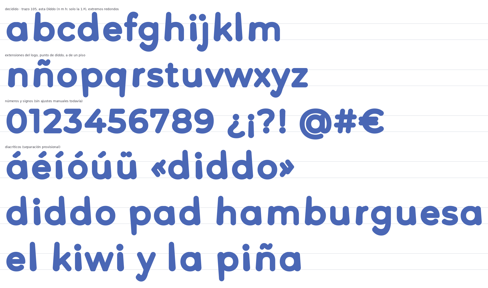
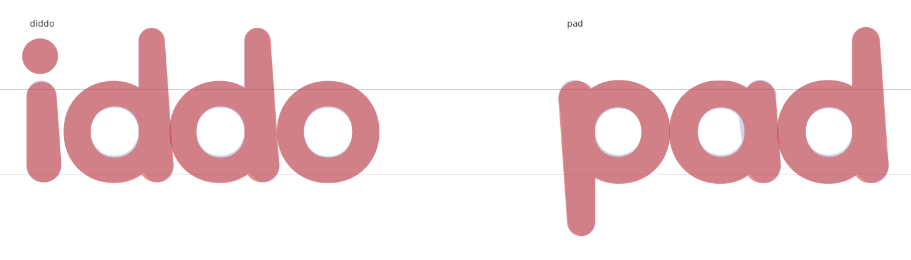
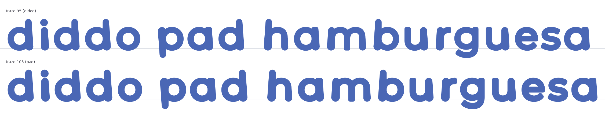
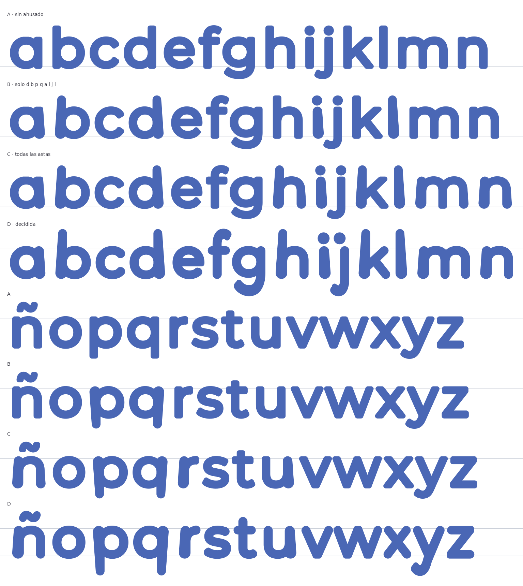
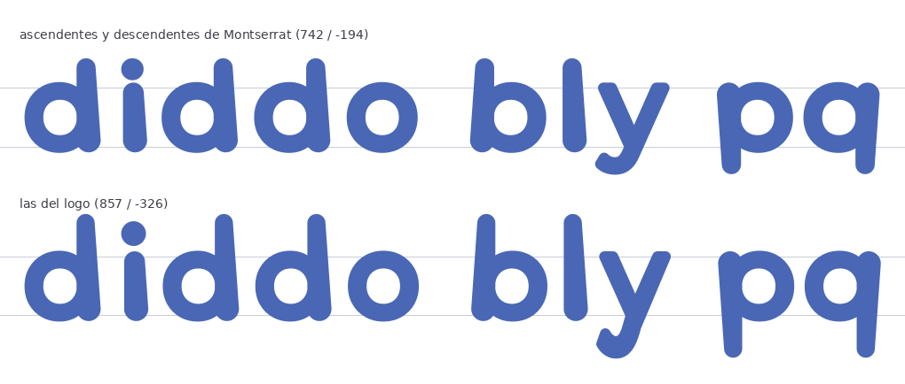

# Diddo Sans: brief de diseño (fase 2)

Estado: **decidido el 2026-10-16** (ver el resumen al final). Este documento es la
especificación de la fase 4 (`scripts/diddoize.py`). Cada punto conserva las opciones
que se compararon y la recomendación que se hizo, junto a la decisión tomada.

Las imágenes salen de `make proof` (`scripts/proof_brief.py`). Son un **prototipo
rápido** construido sobre Montserrat 400, no la fuente: los diacríticos están separados
de forma provisional, no hay kerning y el espaciado es el de Montserrat más el trazo.
Las medidas citadas están en `reference/normalized/medidas.md`, que genera
`make analyze`.

## Lo que ya sabemos (y cambia respecto al análisis inicial)

Al medir con el script han salido cuatro cosas que el primer análisis no recogía o
estimaba mal. Están corregidas en `analisis-logos.md`:

1. **El asta de la d es la misma pieza que la de la i.** Es un trazo ahusado con
   los **dos extremos redondos**: el borde interior es vertical y el exterior se abre
   unos **4°** hacia abajo. El "pie" de la d no es un remate añadido: es el extremo
   redondo de esa asta, que queda separado del cuenco por una **muesca en V**. Todo el
   minúsculo del logo sale de **dos piezas: el cuenco de la o y el asta de la i**.
2. **El ancho del asta depende solo de la altura.** El relleno mide ≈ 86 UPM en la
   altura x y gana ≈ 0,07 UPM por cada UPM que baja, igual en la i que en la d. Queda en
   67 UPM a 800 de altura y en ≈ 124 UPM en la base. El asta de Montserrat 400 mide
   **71 UPM**, no 82.
3. **Las ascendentes y descendentes del logo son mucho más largas que las de
   Montserrat.** La d sube a 857 (Montserrat: 742) y la p baja a −326 (Montserrat: −194).
   Medido en relleno, sin el trazo.
4. **El punto de la i es mayor y está más alto**: ⌀ 125 con el centro a 730, frente a
   ⌀ 104 con el centro a 692 en Montserrat.

Con estas reglas (variante decidida), el prototipo ya reproduce bastante bien las letras del logo
(IoU entre el logo y el prototipo, donde 1 es idéntico):

| i | d | o | p | a |
|---|---|---|---|---|
| 0,982 | 0,958 | 0,979 | 0,954 | 0,953 |

El objetivo de la fase 4 es IoU ≥ 0,98. Lo que falta es, sobre todo, la muesca entre
el cuenco y el asta y la forma exacta del extremo superior.

---

## 1. Peso de referencia

| Opción | Trazo | |
|---|---|---|
| **diddo** | 95 UPM | **Recomendada** |
| pad | 105 UPM | ≈ 10 % más grueso |

Recomendación: 95. Es el logo principal, y la diferencia en texto es pequeña.

**Decisión: 105 UPM, el grosor de pad.**

## 2. Regla del asta (ahusado y extremos redondos)

| Opción | Qué hace |
|---|---|
| A | Sin asta Diddo: Montserrat engrosada tal cual |
| B | Asta Diddo solo en las letras del logo y sus parientes directos: d b p q a i j l |
| **C** | Asta Diddo en todas las astas verticales de minúscula |

En todas, el borde que da al cuenco o al arco queda vertical y se mueve el exterior.
El extremo ancho es el que toca la base, salvo en p y q, que son la d girada y tienen el
extremo ancho en la altura x.

Recomendación: **C**. La B deja la l ahusada junto a una h recta, y eso se lee como un
error. La C extiende la lógica del logo de forma coherente. A cambio, n, h, m, k y r
ganan peso en el pie y la fuente adquiere un aire ligeramente "flare". Hay casos que
la regla automática no cubre y se resolverán a mano en la fase 5:

- La **j**, porque su asta acaba en un gancho.
- La **u**, porque su asta izquierda acaba en curva.
- La **f** y la **t**, porque la barra cruza el asta.
- El asta central de la **m**.

**Decisión: todas las letras con asta Diddo (D), pero en la n y la m solo la primera
asta.** La h es una n con ascendente, así que sigue la misma regla (pendiente de
confirmar). La ñ hereda la regla de la n. La regla D aparece en `2-ahusado.png`. Las
patas sin ahusar siguen llevando el extremo redondo (punto 3).

## 3. El pie de la d

Con lo que se ha aprendido en el punto 2, esta pregunta cambia. El pie no es un rasgo
propio de la d, sino el extremo redondo del asta Diddo. Si eliges B o C, aparece en
todas las letras con asta Diddo (b d p q a, y con C también n h k l r…), porque es la
misma pieza.

Recomendación: tratarlo como parte del asta, sin pie especial para la d.

**Decisión: todos los extremos libres terminan en semicírculo, como en los originales.**
No solo las astas: también los terminales de c, e, s, r, f, t, g, j y y, los brazos de
k, v, w, x, y y z, las barras de f, t y z, los números y los acentos.

- **Regla:** se quita el último medio ancho del trazo y se pone un disco del mismo
  ancho, con la punta donde estaba el extremo. Así la letra no crece.
- **Diagonales** (v, x, k…): el disco no pasa del corte original, de modo que la punta
  toca la base o la altura x.
- **Muesca:** la muesca en V entre cuenco y asta se modela en la fase 4, con la prueba
  de superposición como criterio.

## 4. Mayúsculas

Recomendación: sin ahusar.

**Decisión: la v1 no tiene mayúsculas.** Es una tipografía solo de minúsculas, como los
logos. Consecuencia práctica: si alguien escribe una mayúscula, el programa no encuentra
el glifo y la muestra con otra fuente (o con un recuadro vacío). Hay dos formas de
tratarlo, que quedan por decidir antes de la fase 8:

- **Unicase (recomendada):** A–Z, Ñ y las vocales acentuadas mayúsculas apuntan a las
  mismas minúsculas. Escribir "Diddo" o "DIDDO" da "diddo", sin cambiar de fuente.
  Cuesta cero glifos.
- **Sin asignar:** las mayúsculas no existen y cada programa las sustituye a su manera.

## 5. Ascendentes, descendentes y métricas

| Opción | Ascendente / descendente (relleno) | |
|---|---|---|
| a) Montserrat | 742 / −194 | Más compacta y mejor para varias líneas |
| **b) Logo** | 857 / −326 | **Recomendada**: "diddo" y "pad" compuestos con la fuente coinciden con el logo |

Recomendación: b.

**Decisión: b, las del logo (más largas).**

**Reescalado.** Sin mayúsculas, la referencia ya no puede ser la altura de mayúsculas
(la propuesta anterior era 700). La nueva propuesta es reescalar ×0,909 para que la
**altura x visible sea la de Montserrat (525,5)**. Así, a igual cuerpo, el texto
en minúscula ocupa lo mismo que con Montserrat, y el trazo de 105 queda en ≈ 95 UPM. Estos
valores salen del prototipo decidido; se fijarán al compilar en la fase 4:

| Métrica | Valor visible tras reescalar |
|---|---|
| Altura x | 525,5 |
| Ascendente (d, b, k) | ≈ 827 |
| Acentos (á, í) | ≈ 825 |
| Punto de la i | ≈ 768 |
| Descendente (p) / (g, y, j) | ≈ −344 / −352 |

Propuesta de métricas verticales (esquema de Google Fonts, `USE_TYPO_METRICS`):

- typo y hhea: ascendente 830, descendente −355 y `lineGap` 0, con interlineado por
  defecto de 1,185.
- win: cubrir la caja real de todos los glifos, ≈ 850 / 360.

La altura x del logo (532) es un 1,3 % mayor que la de Montserrat (525,5), pero la
diferencia viene del extremo redondo del asta. Se mantiene la de Montserrat.

## 6. Punto de la i y de la j

Recomendación: el del logo (⌀ 125, centro a 730). Los demás puntos (`. : ; ! ¡ ? ¿`
y la diéresis) se igualan a ese tamaño en la fase 5.

**Decisión: el punto de diddo.**

## 7. El símbolo "D" de diddo

Queda fuera de la v1, como ya estaba decidido. En la v2 podría entrar como alternativa
`ss01` de la D.

---

## Resumen de decisiones

| # | Tema | Decisión |
|---|---|---|
| 1 | Peso | ✅ Trazo de 105 UPM (pad) |
| 2 | Asta Diddo | ✅ En todas las letras. En n y m (y h, pendiente de confirmar) solo la primera asta |
| 3 | Extremos | ✅ Todos los extremos libres redondos (semicírculo), como en los originales |
| 4 | Mayúsculas | ✅ No hay en la v1 · ⏳ unicase o sin asignar (recomendado: unicase) |
| 5 | Extensiones y métricas | ✅ Las del logo · reescalado a altura x de 525,5 (propuesta) |
| 6 | Punto de i/j | ✅ El de diddo |
| 7 | Símbolo D | ✅ Fuera de la v1 |
